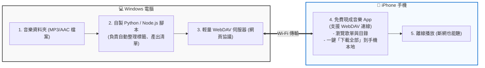

# music-server
Windows 端用 nodejs 自建 WebDAV 音樂伺服器，讓 iPhone 端可以收聽

# 開發概念
不去維護 iOS 內建的 Apple Music 庫，而是開發一個給自己專用的 Windows 傳輸工具。在 iPhone 上則直接安裝 App Store 現成的、支援 WebDAV / SMB 或雲端同步的第三方音樂播放器（例如免費的 Navidrome 相關客戶端、VLC 或 MusicStreamer）。

# 系統架構圖 (System Architecture)

